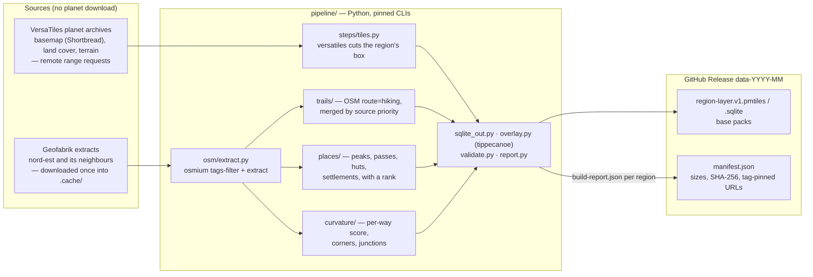
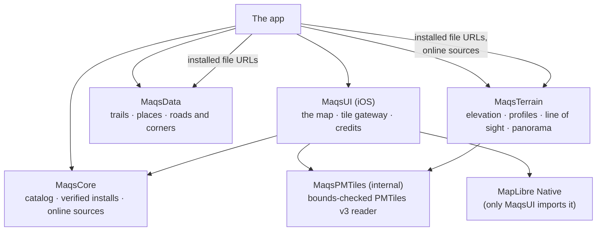

# maqs

Map data and a Swift package for native Apple apps: Shortbread basemap tiles,
land cover, terrarium terrain, hiking trails, places and road curvature, per
region. Online first, offline optional, zero hosting cost: code in this
repository, data as GitHub Release assets, compute in GitHub Actions. One map
provider, [VersaTiles](https://versatiles.org), serves every tile online and
offline.

Two halves live here:
- **The data pipeline** (`pipeline/`, Python): cuts each region from
  VersaTiles' planet archives and filters OpenStreetMap with pinned tools,
  writes PMTiles and SQLite files, validates them, and assembles a
  `manifest.json`. A GitHub Actions workflow builds every region on the 1st of
  each month and publishes a `data-YYYY-MM` release.
- **The `Maqs` Swift package** (`Sources/`): reads those releases on the device.
  `MaqsCore` discovers, downloads and installs region packs; `MaqsTerrain` reads
  elevations and tells which peaks the observer can see; `MaqsData` searches
  trails and places and finds the corners ahead on a road; `MaqsUI` is the map,
  which draws installed regions from their files and streams everywhere else.

**Status:** the pipeline builds all six layers of a region (basemap, land
cover, terrain, trails, places, curvature) and the bundled base packs. The
latest release is `data-2026-11`, with four regions. The package's four
products are built and tested; no package version is tagged yet.
[`docs/BRIEF.md`](docs/BRIEF.md) has the plan and
[`docs/decisions.md`](docs/decisions.md) has every decision and the numbers
behind it (ADRs 0001–0021).

| | |
|---|---|
| **Package** | `Maqs`, Swift tools 6.2, iOS 18 and macOS 15; four library products |
| **Dependencies** | one: MapLibre Native (6.31.0 up to the next major), linked by `MaqsUI` on iOS only; the other products use system frameworks only |
| **Map rendering** | iOS only; on macOS `MaqsUI` builds without MapLibre (ADR 0003) |
| **Warnings** | errors, from the CI commands (`-Xswiftc -warnings-as-errors`), not from `Package.swift` (ADR 0018) |
| **Pipeline** | Python 3.12 with uv; versatiles 5.16.0, pmtiles 1.31.2, osmium-tool 1.19.1, tippecanoe 2.79.0, pinned in `pipeline/bootstrap.sh` |
| **Regions** | `triveneto`, `veneto`, `friuli-venezia-giulia`, `trentino-alto-adige`, and the `test` fixture, which is never published |
| **Data releases** | `data-YYYY-MM`, monthly, on GitHub Releases; clients read `releases/latest/download/manifest.json` |
| **Licences** | code Apache-2.0; data ODbL and CC BY 4.0, with every provider's attribution in `DATA_LICENSE.md` |

> `CLAUDE.md` is the engineering contract: workflow, conventions, hard rules,
> budgets and the "things that will bite you" list. `docs/BRIEF.md` is the
> source of truth for what to build; `docs/decisions.md` records why things are
> the way they are. This README is how to use the data and the package, the
> developer overview, and the guide to every file.

## Table of contents

- [Data releases](#data-releases)
- [Swift package](#swift-package)
- [Demo app](#demo-app)
- [Architecture](#architecture)
- [Repository guide](#repository-guide)
- [Getting started](#getting-started)
- [Environment](#environment)
- [Building & testing](#building--testing)
- [Build a region locally](#build-a-region-locally)
- [Linting, formatting & checks](#linting-formatting--checks)
- [Continuous integration](#continuous-integration)
- [Releasing](#releasing)
- [Network & privacy](#network--privacy)
- [Conventions](#conventions)
- [Design docs](#design-docs)
- [Known limits](#known-limits)
- [Roadmap](#roadmap)
- [Licences](#licences)

## Data releases

A GitHub Actions workflow, [`build-maps.yml`](.github/workflows/build-maps.yml), builds every region at 03:00 UTC on the 1st of each month and publishes a GitHub Release tagged `data-YYYY-MM`, marked latest. Each release holds a `manifest.json`, the base pack files, and the files of every region in `config/regions.yaml` except the `test` fixture. The latest release is `data-2026-11`; the first was `data-2026-10`. Clients read `https://github.com/lucavallin/maqs/releases/latest/download/manifest.json`, which lists each file with its size, its SHA-256 and a URL pinned to its release. The online tile sources are in [`config/sources.json`](config/sources.json), which clients read from `main`. A client picks the files it can read by the [compatibility rule](docs/data-format.md#compatibility-rule).

To run the workflow by hand, for example after a failed month:

```sh
gh workflow run build-maps.yml                 # every region and the base packs; publishes this month's release
gh workflow run build-maps.yml -f region=test  # one region (or base): builds it and uploads the dist-test artifact; publishes nothing
```

A run in a month that already has a release deletes and re-uploads that release's files of the same name, the manifest last. It never touches an older release, and when it succeeds every file the new manifest names is there. Only a run on `main` publishes. A dispatch with `-f region=…` or `-f layers=…`, or one on another branch with `--ref`, only builds, and keeps its outputs as workflow artifacts for 7 days. [`docs/architecture.md`](docs/architecture.md#data-releases) explains the jobs, and ADR 0013 in [`docs/decisions.md`](docs/decisions.md) gives the reasons.

## Swift package

The `Maqs` Swift package (iOS 18, macOS 15) reads these releases on the device. It has four products, so an app links only what it uses:

| Product | What it does | State |
|---|---|---|
| `MaqsCore` | the region catalog from the latest manifest, verified downloads and installs, the online tile sources | built and tested, unreleased |
| `MaqsTerrain` | elevation at a point, along a route, on a grid or along a profile, and line of sight, from installed packs or online tiles | built and tested, unreleased |
| `MaqsData` | trail search, places along a bearing, road segments and the corners ahead, from the installed files | built and tested, unreleased |
| `MaqsUI` | a SwiftUI map over MapLibre Native, from installed packs or online, with the app's lines and markers, the trails and places overlays and the credits; iOS only | built and tested, unreleased |

No package version is tagged yet.

`MaqsCore` uses system frameworks only. A minimal use, from the main actor:

```swift
import MaqsCore

var configuration = MaqsConfiguration(layers: [.basemap, .terrain, .trails], userAgent: "MyApp/1.0 (iOS)")
configuration.backgroundSessionIdentifier = "com.example.myapp.maqs"  // iOS: downloads go on in the background
let maqs = try Maqs(configuration: configuration)                     // once per process, on the main actor

let catalog = try await maqs.refreshCatalog()                         // what the latest data release offers
for region in catalog.regions {
    print(region.names["en"] ?? "", region.totalBytes, region.status)
}
try await maqs.install(.region("veneto"))                             // size and SHA-256 checked, then moved into place
print(maqs.state.packs[.region("veneto")] ?? .notInstalled)           // the state SwiftUI observes
if let pack = await maqs.installedPack(.region("veneto")) {
    print(pack.files[.terrain]?.first?.url as Any)                    // a file URL to hand to MaqsTerrain
}
```

The `userAgent` names your app, because the free tile providers ask for an identifying User-Agent. On iOS, forward `application(_:handleEventsForBackgroundURLSession:completionHandler:)` to `maqs.handleEventsForBackgroundURLSession(identifier:completionHandler:)`. After a relaunch, call `install` again for the packs the user had asked for, because the package does not remember them; the call joins a download that is still running, or reuses one that finished after a size and hash check, instead of downloading it again. Set `onlineTiles` to `false` and the package hands out no online tile source, so no position leaves the device through it. [`docs/architecture.md`](docs/architecture.md#swift-package) explains discovery and installs, and ADR 0014 in [`docs/decisions.md`](docs/decisions.md) gives the reasons.

`MaqsTerrain` also uses system frameworks only, and it never imports `MaqsCore`: the app hands it the terrain files of the installed packs and, for everywhere else, the online terrain source. Continuing the example:

```swift
import CoreLocation
import MaqsTerrain

let pack = await maqs.installedPack(.region("veneto"))
let archives = [Layer.terrain, .terrainHD].flatMap { pack?.files[$0] ?? [] }.map(\.url)

// nil when onlineTiles is false: then MaqsTerrain never makes a request
let online = try await maqs.onlineSources?.terrain.first.map { source in
    try OnlineTerrainSource(tiles: source.tiles, format: source.format, tileSize: source.tileSize ?? 512,
                            minZoom: source.minZoom, maxZoom: source.maxZoom)
}
let terrain = try Terrain(configuration: TerrainConfiguration(archives: archives, online: online,
                                                              userAgent: "MyApp/1.0 (iOS)"))

let here = CLLocationCoordinate2D(latitude: 46.10, longitude: 12.25)
print(try await terrain.elevation(at: here))                      // .elevation(metres) or .missing(reason)

let peak = SightTarget(coordinate: CLLocationCoordinate2D(latitude: 46.21, longitude: 12.18),
                       elevation: 2_145)                           // the summit's OSM ele, when known
for result in try await terrain.visibility(of: [peak], from: Observer(coordinate: here)) {
    switch result {
    case .visible(let distance, let bearing, let angle): print("visible", distance, bearing, angle)
    case .hidden(_, _, let blockedDistance, _, _, _): print("hidden by ground", blockedDistance, "m away")
    case .unknown(_, let reason, _): print("unknown", reason)      // ground missing, or online tiles failed
    case .outOfRange: print("too far")
    }
}

// The ridges ahead, band by band: 30° around north-north-east, every 0.5°, in bands to 200 km.
let fan = try PanoramaBearings(centre: 22, halfWidth: 15, step: 0.5)
let ridges = try await terrain.panorama(from: Observer(coordinate: here), bearings: fan,
                                        bands: [0, 10_000, 30_000, 60_000, 200_000])
print(ridges.columns.first?.ridges.map { $0?.angle } as Any)       // radians above the eye, nil where a band has no ground
```

Inside an installed region the elevations come from the pack, and a look fetches online only the ground beyond the pack's border. Elsewhere the package fetches VersaTiles' tiles through the HTTP cache, at most four at a time and 128 per call, and pauses after a 429. A missing value carries its reason, so an app can tell "no data here" from "try again later". Create one `Terrain` and share it: the pause after a 429, the limit of four requests and the HTTP cache directory belong to one instance, so a second instance would double the requests and ignore the first one's pause. The tiles of one online look give away roughly where the user stands, to about 500 m; an app that must not reveal that sets `onlineTiles` to `false`, and `onlineSources` is then nil. After an install, an update or a removal, pass the new file URLs to `terrain.setArchives(_:)`. [`docs/architecture.md`](docs/architecture.md#terrain) describes the sources, the results and the online path, and ADR 0015 in [`docs/decisions.md`](docs/decisions.md) gives the reasons.

`MaqsData` imports no other product either: it takes the SQLite files of the installed packs and works offline. Continuing the example (`MaqsCore` is imported only for `Layer` and the installed `pack`; `terrain`, `here` and `Observer` come from the `MaqsTerrain` block):

```swift
import MaqsCore
import MaqsData
import MaqsTerrain

// the SQLite files only: trails and places also list a tile overlay, with role "overlay"
let files = { (layer: Layer) in (pack?.files[layer] ?? []).filter { $0.role == nil }.map(\.url) }
let trails = try Trails(files: files(.trails))
let places = try Places(files: files(.places))
let roads = try Roads(files: files(.curvature))

// Trail search: the exact number first, then numbers inside a ref (926A, E926), then text.
for trail in try await trails.search("926", near: here, limit: 5) {
    print(trail.ref ?? "", trail.name ?? "", trail.geometryStatus)
}

// Places by name, in any of their languages; accents and case are ignored, the last word is a prefix.
let found = try await places.search("monte gra", kinds: [.peak], limit: 20)

// Places along a sight line: a cone from where the user stands, handed to MaqsTerrain.
let cone = try BearingCone(origin: here, bearing: 40, halfAngle: 5, maxDistance: 100_000)
let targets = try await places.places(in: cone, kinds: [.peak], limit: 20)
    .map { SightTarget(coordinate: $0.place.coordinate, elevation: $0.place.elevation) }
let looks = try await terrain.visibility(of: targets, from: Observer(coordinate: here))

// Corners ahead: the app matches the position to a segment, MaqsData walks on from there.
if let near = try await roads.segments(near: here).first {
    let position = RoadPosition(segment: near.segment, direction: .forward, along: near.along)
    let ahead = try await roads.cornersAhead(from: position, distance: 1_000)
    for corner in ahead.corners {
        print(corner.turn, corner.minRadius, corner.entry, corner.afterFork)  // afterFork: past a guessed branch
    }
}
```

Matching a position to a road, and choosing the direction of travel, stay with the app; `MaqsData` returns the segments near a position, with the heading at the nearest point, to match against. Where the road forks, the lookahead takes the likeliest branch (same `ref`, then `name`, then `highway`, then the smallest turn) and marks the corners after it. After an install, an update or a removal, pass the new URLs to `setFiles(_:)` on each reader: SQLite fails reads from a file that was replaced while open. Curvature files built before the `junctions` table (`data-2026-10`) only link roads at way ends, so the lookahead stops at many ordinary junctions until the next monthly release. [`docs/architecture.md`](docs/architecture.md#data) describes the readers, and ADR 0016 in [`docs/decisions.md`](docs/decisions.md) gives the rules and the measurements.

`MaqsUI` is the map, for iOS. It is the only product that links MapLibre Native, and apps never import MapLibre themselves. Continuing the example (`here` and `peak` come from the `MaqsTerrain` block, `trails` from the `MaqsData` one):

```swift
import MaqsCore
import MaqsData
import MaqsUI
import SwiftUI

// Create the first MaqsMap before any map view exists in the process: it puts the tile gateway in front of MapLibre.
let map = try MaqsMap(maqs: maqs, configuration: MapConfiguration(accent: .orange))
map.overlays = MapOverlays(trails: true, places: nil)        // the installed regions' trails and every place kind
map.lines = [MapLine(id: "track", coordinates: [here, peak.coordinate])]
map.activeLineID = "track"                                    // the one line drawn in the accent
map.markers = [MapMarker(id: "peak", coordinate: peak.coordinate, label: "Peak", rank: 2565)] // ranked: gives way when crowded
map.onTap = { [weak map] tap in                               // what the tap touched, topmost first
    guard case .trail(let feature)? = tap.hits.first else { return }
    map?.selectedOverlayFeature = feature                     // the trail in the accent
    Task { print(try await trails.trail(region: feature.region, featureID: feature.featureID) as Any) }
}
map.onLongPress = { tap in print("held at", tap.coordinate) }  // a half-second hold, reported once

struct MapScreen: View {
    let map: MaqsMap
    var body: some View {
        MaqsMapView(map: map)
            .ignoresSafeArea()
            .overlay(alignment: .bottomLeading) { MapAttributionView(map: map).padding() }
    }
}
```

Inside an installed region the map draws everything from the downloaded files and sends no tile request, even with signal; elsewhere it streams the `sources.json` provider's tiles, and with no network it shows what it cached earlier. Installing or removing a pack changes what it draws without a new view. The map draws only the layers the `Maqs` configuration names: the basemap always, hillshade with `.terrain`, the overlays with `.trails` and `.places`. A 429 from the provider pauses online tiles for at least a minute, and `onlineTilesPaused` says so.

The app draws its own controls: the map hides MapLibre's compass, logo and attribution button, and `follow(_:)`, `resetNorth()`, `setPitch(_:)` and `show(_:)` are there for the app's buttons. `connectivity` and `uninstalledRegion` tell the app when to offer a download, and `credits` lists the sources the map draws, which `MapAttributionView` shows. Set `contentInsets` to the room your chrome takes, and count the status bar and the home indicator in when the map runs under them.

A line can be several runs drawn as one, `MapLine(id:segments:)`, so the active line can be every stretch of a sight line that is in view. Each marker the map draws is also a button for VoiceOver, labelled with its label.

A custom style needs a vector source named `basemap`, a vector source named `landcover` for land cover, and a `raster-dem` source named `terrain` for hillshade; the package fills in the tiles, fonts and sprite. Any other source in it is fetched by MapLibre directly, so it needs the network even inside an installed region. [`docs/architecture.md`](docs/architecture.md#map) has the contract and the design rules, and ADR 0017 in [`docs/decisions.md`](docs/decisions.md) has the reasons.

`MaqsUI` never asks for location permission. An app that shows the user's location sets `NSLocationWhenInUseUsageDescription` in its Info.plist and asks for permission itself, with `CLLocationManager.requestWhenInUseAuthorization()`, before it sets the map's `userLocation` to `.system`; `.provided` shows the fixes the app passes to `provide(_:)` instead. One prompt can still come from MapLibre: if the app's Info.plist declares `NSLocationTemporaryUsageDescriptionDictionary` with an `MLNAccuracyAuthorizationDescription` purpose, MapLibre may ask for temporary full accuracy.

`swift build` and `swift test` run from a clean checkout: the tests read the `test` region's files committed under `Tests/MaqsTestSupport/Fixtures/`. `scripts/update-fixtures.sh` rebuilds them with the pipeline, writes the pipeline's terrain and data-layer values that the Swift tests compare against, and refreshes the copy of `sources.json` bundled in the package. The map's glyphs, sprite and default styles under `Sources/MaqsUI/MapAssets/` come from pinned VersaTiles releases through `scripts/update-map-assets.sh`. `swift test` on macOS runs the map's pure tests; the tests that draw a map run on the iOS Simulator, with the command in [`CONTRIBUTING.md`](CONTRIBUTING.md).

## Demo app

`Examples/MaqsDemo` is a small SwiftUI app for iOS 18. It uses the four products through the local package and nothing else. Open `Examples/MaqsDemo/MaqsDemo.xcodeproj` in Xcode and run it on a simulator. For a device, pick your own team under Signing, since the project names none, and change the bundle id to one your team can sign. CI only builds it:

```sh
xcodebuild -project Examples/MaqsDemo/MaqsDemo.xcodeproj -scheme MaqsDemo -destination 'generic/platform=iOS Simulator' CODE_SIGNING_ALLOWED=NO build
```

Before a package release, walk through it by hand on a simulator and on a device:

1. Online map. The map opens over Friuli-Venezia Giulia with VersaTiles tiles, the credits at the bottom. The buttons at the top right show and follow your location and turn the map north. The first tap on the location button brings up the system's permission prompt, which the app asks for.
2. Download a region. Regions lists the latest data release. Download `friuli-venezia-giulia` and watch the progress in its row. Its basemap, terrain, trails and places come to 230,320,216 bytes (about 230 MB) in `data-2026-10`, read from the live manifest on 2026-10-29. When the map's centre is over a region that is not installed, a banner offers it.
3. Airplane mode. On a device with the region installed, turn on airplane mode. The offline banner appears, and inside the region the map still draws everything from the downloaded files; outside it, you only see what the map cached earlier. The simulator shares the Mac's network and cannot go offline by itself. Launch it there with the argument `-onlineTiles NO` instead: the package then hands out no online source, and the map draws only from the installed files.
4. Trail search. Trails searches the installed regions by number, name or place. The trail you pick is drawn in the accent colour and shown whole. Tap a trail on the map to open its record.
5. Places along a bearing. Sight line starts at the map's centre. Move the bearing slider: the line is solid where the ground is in sight and dashed where it isn't, and the places near it show as markers, greyed out when they can't be seen.
6. Elevation profile. The same sheet charts the ground along the line.

## Architecture

Two halves joined by one contract: the file formats and the manifest in
[`docs/data-format.md`](docs/data-format.md). The pipeline writes them, the
package reads them, and neither knows anything else about the other.
[`docs/architecture.md`](docs/architecture.md) is the authoritative version of
this section.

### The pipeline



- **Tile layers** (basemap, land cover, terrain, and optional HD terrain) are
  cut from VersaTiles' planet archives by remote range requests: no planet ever
  lands on the runner (ADR 0004).
- **Data layers** (trails, places, curvature) read the region's Geofabrik
  extract, filtered and cut with osmium, then parsed with pyosmium. Each writes
  one SQLite file with an R\*Tree and, for trails and places, an FTS5 index and
  a vector overlay for the map.
- **Every output is validated** before it is reported, and every build writes
  a `build-report.json`: what was built, from what, with which tools. The
  manifest is assembled from the reports; `release.py` checks every asset
  before anything is published.
- **Regions** are entries in `config/regions.yaml`, checked against
  `config/schemas/` on load. `test` is a small box around Nevegal that builds
  every layer in under five minutes and is never published.

### The package



| Module | Imports |
|---|---|
| `MaqsCore` | system frameworks only: Foundation, CryptoKit, Observation, Synchronization, os |
| `MaqsTerrain` | Foundation, CoreLocation, CoreGraphics, ImageIO, os; and `MaqsPMTiles` |
| `MaqsData` | system frameworks only: Foundation, SQLite3, CoreLocation, os |
| `MaqsUI` | MapLibre Native (the only module in `Sources/` that imports it, enforced in CI); `MaqsCore` and `MaqsPMTiles`; Foundation, SwiftUI, UIKit, CoreLocation, Network, CryptoKit, Synchronization, os |
| `MaqsPMTiles` | internal target, `package` access only: Foundation, Compression, Synchronization |

Dependencies point one way. `MaqsTerrain` and `MaqsData` import nothing from
`MaqsCore`: the app hands them the file URLs of an installed pack, so an app
can link `MaqsData` alone. Every reader is an actor or a `Sendable` struct over
a connection; `@MainActor` appears only on SwiftUI-facing state (`MaqsState`,
`MaqsMap`).

## Repository guide

Every directory and file, and what it does. The map's glyph and sprite files
and the binary test fixtures are listed by folder.

### Top level

```
maqs/
├── Package.swift            # the Maqs package: four products, the internal MaqsPMTiles, MaqsTestSupport, MapLibre
├── Package.resolved         # MapLibre Native's pinned revision
├── Sources/                 # the package's modules (below)
├── Tests/                   # the package's tests and the committed test-region fixtures (below)
├── Examples/MaqsDemo/       # a small SwiftUI app over the four products (below)
├── pipeline/                # the Python data pipeline (below)
├── config/                  # regions.yaml, sources.json and their JSON Schemas (below)
├── scripts/                 # fixture, golden and map-asset generators (below)
├── docs/                    # the brief, architecture, data format, decisions, specs and plans
├── .github/workflows/       # swift.yml, pipeline.yml, build-maps.yml (see Continuous integration)
├── .claude/settings.json    # Claude Code's permission allow and deny lists for this repository
├── .gitignore               # Xcode and Swift build output, .cache/, dist/, Python caches, machine-local tool state
├── CLAUDE.md                # the engineering contract — how to work here
├── README.md                # this file
├── CONTRIBUTING.md          # the commands for the pipeline and the package; how to propose a change
├── SECURITY.md              # how to report a vulnerability
├── DATA_LICENSE.md          # the data's licences and the exact attribution strings, checked against the sources
└── LICENSE                  # Apache-2.0, for the code
```

### `Sources/MaqsCore/` — discovery, downloads, installs

```
MaqsCore/
├── Maqs.swift                     # the entry point: one instance per process; the catalog, installs, removals,
│                                  #   installed packs, online sources, the background-session hand-off
├── MaqsConfiguration.swift        # what the app says once: layers, user agent, storage, background session,
│                                  #   online tiles on or off
├── MaqsState.swift                # the observable face for SwiftUI, written only on the main actor
├── MaqsError.swift                # every error MaqsCore throws, by subsystem, with recovery text
├── MaqsVersion.swift              # the version sent in the User-Agent
├── Layer.swift                    # a data layer of a region pack, as the manifest names it
├── PackID.swift                   # a region or a base pack
├── PackState.swift                # where a pack is in its install lifecycle
├── DownloadProgress.swift         # bytes received and expected, over every file of a pack
├── DiskUsage.swift                # bytes the package keeps on disk
├── OnlineSources.swift            # the online tile providers from sources.json, per layer, in priority order
├── Logging.swift                  # the module's os.Logger
├── Catalog/
│   ├── Catalog.swift              # what the latest release offers, filtered to the app's layers, against what
│   │                              #   is installed
│   ├── CatalogBuilder.swift       # derives the catalog from the manifest, the layers and the installed packs
│   ├── PackSummary.swift          # one region or base pack as the catalog shows it
│   ├── PackStatus.swift           # an installed pack against the latest release: current, update, unreadable
│   ├── LayerAvailability.swift    # what the latest release offers for one layer of one pack
│   ├── Attribution.swift          # a credit the data requires, from the manifest
│   └── BoundingBox.swift          # a WGS 84 box, longitude first as in the data files
├── Install/
│   ├── Installer.swift            # one pack: download every file (two at once), verify size and SHA-256, move
│   │                              #   into place, write pack.json last, sweep what the record no longer names
│   └── FileHash.swift             # streaming SHA-256, 1 MiB at a time
├── Manifest/
│   ├── Manifest.swift             # manifest.json as published (manifest_version 1); internal
│   └── ReadableVersions.swift     # the client half of the compatibility rule
├── Network/
│   ├── DownloadSession.swift      # delegate-driven URLSession downloads with async callers, background-capable
│   ├── HTTPClient.swift           # document fetches that always ask, with If-None-Match, so an unchanged
│   │                              #   document costs no body
│   ├── ManifestClient.swift       # fetches, validates and caches manifest.json; a failure keeps the cache
│   ├── SourcesClient.swift        # sources.json: cached first, the bundled copy as the fallback
│   ├── SourcesDocument.swift      # strict decoding of sources.json: HTTPS only, the schema's promises
│   └── TransferError.swift        # why one transfer did not complete
├── Storage/
│   ├── StorageLayout.swift        # every path under the storage root; nothing else builds a path
│   ├── PackStore.swift            # the storage root: out of backups, pack.json, atomic moves
│   ├── PackRecord.swift           # one installed file as pack.json records it, by relative path
│   └── CachedDocument.swift       # a fetched document and its metadata, written atomically
└── Resources/sources.json         # the bundled fallback: a byte copy of config/sources.json, checked by CI
```

### `Sources/MaqsTerrain/` — elevation and line of sight

```
MaqsTerrain/
├── Terrain.swift                  # the actor: elevation at a point, along a route, on a grid, along a profile;
│                                  #   tiles from installed archives first, then online
├── Terrain+Visibility.swift       # visibility(of:from:): visible, hidden (with where), unknown, out of range
├── Terrain+Panorama.swift         # panorama(from:bearings:bands:): the highest ridge per distance band across a
│                                  #   fan, read in bounded chunks of samples
├── TerrainVersion.swift           # the version in the User-Agent; CI checks it equals MaqsCore's
├── Logging.swift
├── Geodesy/Geodesy.swift          # great-circle geometry on the mean-radius sphere
├── PMTiles/PMTilesError.swift     # why a PMTiles file could not be read (damaged, truncated, not PMTiles)
├── Providers/
│   ├── TileProvider.swift         # the provider protocol; online failures are values, local errors are thrown
│   ├── LocalTileProvider.swift    # tiles from an installed PMTiles archive
│   ├── OnlineTileProvider.swift   # a terrarium source online: identifying User-Agent, HTTP cache, four requests
│   │                              #   at once, one request per tile however many callers want it
│   ├── AsyncLimiter.swift         # at most N bodies at once, in arrival order, cancellable while waiting
│   └── CoolDown.swift             # the pause after a 429: 60 s, doubling to 900 s
├── Public/
│   ├── TerrainConfiguration.swift # archives, the online source, the user agent, the cache sizes
│   ├── OnlineTerrainSource.swift  # an online source, checked once: HTTPS, the right host, sane zooms
│   ├── Observer.swift             # where the eye is, and how high above the ground or sea
│   ├── SightTarget.swift          # something to look at, with its elevation when known
│   ├── Visibility.swift           # the answer for one target, with the horizon of a hidden one
│   ├── VisibilityOptions.swift    # range, margin, target clearance, the Earth model
│   ├── EarthModel.swift           # curvature drop with refraction folded in (k = 0.13)
│   ├── ProfileOptions.swift       # profile spacing and the Earth model
│   ├── ElevationProfile.swift     # the samples along a profile, with the apparent elevation
│   ├── ElevationSample.swift      # an elevation, or why there is none
│   ├── ElevationGrid.swift        # samples on a regular grid
│   ├── Panorama.swift             # PanoramaBearings and the panorama's columns and ridges
│   ├── TerrainArea.swift          # a box of at most two degrees a side
│   ├── TerrainError.swift         # bad input or a damaged file, never a network failure
│   └── ZoomBands.swift            # coarser zooms with distance (z12 near, z9 beyond 40 km)
└── Tiles/
    ├── TileKey.swift              # an XYZ tile address
    ├── WebMercator.swift          # tile arithmetic, mirroring the pipeline's
    ├── Terrarium.swift            # metres = (R × 256 + G + B / 256) − 32768
    ├── TerrariumDecoder.swift     # WebP or PNG to an elevation tile through ImageIO
    ├── ElevationTile.swift        # a decoded tile, sampled with the pipeline's bilinear rule
    └── TileCache.swift            # the bounded LRU of decoded tiles, keyed by provider and tile
```

### `Sources/MaqsData/` — trails, places, roads

```
MaqsData/
├── Trails/
│   ├── Trails.swift               # search and lookup over the installed trails files
│   ├── TrailSearch.swift          # the three tiers: exact number or name, numbers inside a ref, full text
│   └── TrailRows.swift            # the trails SQL and row decoding
├── Places/Places.swift            # places in a bearing cone, in an area, by name (FTS5), by id
├── Roads/
│   ├── Roads.swift                # segments near a position, by way id, and the corners ahead
│   └── LookaheadWalk.swift        # the walk behind cornersAhead: junction to junction, the likeliest branch
├── Curvature/Curvature.swift      # the pipeline's corner formula, for a recorded track
├── Geometry/
│   ├── Geodesy.swift              # great-circle geometry on the pipeline's sphere
│   └── Polyline6.swift            # decoding the files' encoded polylines
├── Store/
│   ├── SQLite.swift               # read-only immutable connections: no locks, no journal, no -wal or -shm
│   ├── LayerFile.swift            # opening a layer file and checking its metadata, tables and schema version
│   └── FullText.swift             # the FTS5 rule both searches share: quoted words, the last a prefix, ss and ß
├── Logging.swift
└── Public/                        # the value types the readers return
    ├── Trail.swift · TrailSummary.swift · TrailID.swift · TrailDifficulty.swift · GeometryStatus.swift
    ├── Place.swift · PlaceID.swift · PlaceKind.swift · PlaceInCone.swift · BearingCone.swift · QueryArea.swift
    ├── RoadSegment.swift · NearbySegment.swift · RoadPosition.swift · RoadBranch.swift · OneWay.swift
    ├── TravelDirection.swift · Lookahead.swift · PathStep.swift · Fork.swift · UpcomingCorner.swift
    ├── Corner.swift · Turn.swift · CurvatureAnalysis.swift
    └── QueryError.swift           # why a reader could not open its files or answer; names files, never paths
```

### `Sources/MaqsPMTiles/` — the shared reader (internal)

```
MaqsPMTiles/
├── PMTilesArchive.swift           # positioned reads on one descriptor; every offset and length checked first
├── PMTilesHeader.swift            # the 127-byte header and the compressions decoded
├── Directory.swift                # directory entries and leaf pointers
├── TileID.swift                   # Hilbert-curve tile ids
├── Gzip.swift                     # gzip members and CRC-32
└── PMTilesReadError.swift         # why a read failed; MaqsTerrain maps each case to its public error
```

### `Sources/MaqsUI/` — the map (iOS)

```
MaqsUI/
├── MaqsUI.swift                   # the module's overview
├── Map/
│   ├── MaqsMap.swift              # the map's model: style, lines, markers, overlays, camera, location, taps,
│   │                              #   connectivity, credits; the first one in a process sets up the gateway
│   ├── MaqsMapView.swift          # the SwiftUI view; light or dark style by the environment; no ornaments
│   ├── OrnamentlessMapView.swift  # MapLibre's view without its ornaments in the accessibility tree, with the
│   │                              #   markers in it
│   ├── MapNetwork.swift           # MapLibre's network set-up, once per process, before the first map view
│   ├── MapInputs.swift            # an archive's zoom range and bounds, from its header
│   ├── ProvidedLocationManager.swift # the location the app passes itself (.provided); never asks permission
│   └── Connectivity+Monitor.swift # connectivity from NWPathMonitor
├── Gateway/
│   ├── TileGateway.swift          # answers MapLibre's tile requests: an installed archive, the network, or a
│   │                              #   base pack when the network cannot answer
│   ├── GatewayState.swift         # the decisions: templates, whether online is allowed, the pause
│   ├── TileRouter.swift           # which installed file serves a tile
│   ├── TileTemplates.swift        # the tile layers MapLibre asks for
│   └── RateLimitPause.swift       # the pause after a 429
├── Style/
│   ├── StyleAssembler.swift       # the one style JSON the map loads: base style, sources, overlays, content
│   ├── StyleInputs.swift          # tile templates and their limits
│   └── BundledAssets.swift        # the glyphs, sprite and default styles in the bundle
├── Content/
│   ├── LineFeatures.swift         # the app's lines as GeoJSON
│   ├── MarkerFeatures.swift       # the app's markers as GeoJSON, ranked
│   ├── MarkerImages.swift         # the markers' images, named by a stable SHA-256
│   ├── ImageDigests.swift         # one digest per image instance
│   ├── MarkerAccessibility.swift  # the drawn markers read back for VoiceOver
│   └── GeoJSONInput.swift         # input hygiene for lines and markers
├── Attribution/
│   ├── Credits.swift              # the credits for the layers being drawn
│   ├── MapAttributionView.swift   # the credits view the app places in its chrome
│   └── RegionOffer.swift          # the region to offer for the map's centre
├── Public/                        # MapConfiguration, MapStyle, MapLine, MapMarker, MarkerContent,
│                                  #   MapOverlays, OverlayFeature, MapTap, MapHit, MapCamera, FollowMode,
│                                  #   UserLocationMode, Connectivity, MapCredit, MapError, PointOfInterest
├── Logging.swift
└── MapAssets/                     # generated by scripts/update-map-assets.sh from pinned VersaTiles releases
    ├── glyphs/noto_sans_{regular,bold}/ # the label glyph ranges the styles use
    ├── sprite/base{,@2x}.{json,png}     # the icons
    ├── styles/default-{light,dark}.json # the package's muted default styles
    └── LICENSES.md                # the assets' licences
```

### `Tests/` — the package's tests

Swift Testing. The tests read the `test` region's outputs committed under
`Tests/MaqsTestSupport/Fixtures/` and stub every network request: no test needs
the network or Python. The map's tests that draw run on the iOS Simulator.

```
Tests/
├── MaqsTestSupport/                # a test-only target the test targets share
│   ├── Sources/                    # Fixtures (the committed outputs), StubServer (scripted HTTP),
│   │                               #   PMTilesWriter, GzipMember, SHA256Hex, TemporaryDirectory
│   └── Fixtures/                   # the test region: basemap, land cover, terrain, trails, places and
│                                   #   curvature files, manifest.json (the data-ci manifest), and the
│                                   #   pipeline's golden values (terrain-golden.json, data-golden.json)
├── MaqsCoreTests/                  # manifest and compatibility, catalog, base packs, storage, downloads,
│                                   #   installs (bad checksum rejected, atomic), sources, errors, the stub server
├── MaqsTerrainTests/               # terrarium decoding, Web Mercator, tiles and their cache, local and online
│   │                               #   providers, the limiter and cool-down, sampling and batching, elevation,
│   │                               #   grids, profiles, the Earth model, visibility, the panorama, zoom bands,
│   │                               #   configuration and errors; FullLookMeasurement prints timings
│   └── Support/                    # SyntheticTerrain, GatedTerrain, Golden
├── MaqsDataTests/                  # trails and trail search, places in a cone, in an area and by name, place
│   │                               #   kinds, roads and the lookahead, curvature, polylines, geodesy, files
│   │                               #   removed under an open reader; QueryMeasurement prints timings
│   └── Support/                    # LayerFileWriter, RoadNetwork, Polyline6Encoder, DataGolden
├── MaqsPMTilesTests/               # the archive, directories, tile ids, gzip, against the pipeline's goldens
└── MaqsUITests/                    # the style assembler, bundled assets, credits, lines and markers, marker
    │                               #   images and accessibility, the gateway, router and templates, the pause,
    │                               #   region offers; on the simulator, real MapLibre views (loading, content,
    │                               #   camera, attribution) behind a network tripwire
    └── Support/                    # MapHost, TestRegion, NetworkTripwire, AccessibilityTree, Waiting
```

### `Examples/MaqsDemo/` — the demo app

```
Examples/MaqsDemo/
├── MaqsDemo.xcodeproj/            # the project, the shared MaqsDemo scheme, MapLibre pinned as the root's
├── MaqsDemo-Info.plist            # the partial Info.plist (one scene)
└── MaqsDemo/
    ├── MaqsDemoApp.swift          # one map screen with a few sheets, through the public API only
    ├── AppDelegate.swift          # hands the background session's events to Maqs
    ├── Demo.swift                 # the one model, made on first use by the scene or the delegate
    ├── DemoModel.swift            # one Maqs, one map, the readers over the installed files, the sheet
    ├── MapScreen.swift            # the map and the app's own chrome
    ├── DemoSheet.swift            # the sheets
    ├── RegionsSheet.swift         # the catalog: download, cancel, remove
    ├── TrailSearchSheet.swift     # trail search; the chosen trail in the accent
    ├── TrailRecordSheet.swift · PlaceRecordSheet.swift # a tapped trail's or place's record
    ├── SightLineSheet.swift       # places along a bearing, the sight line, the profile
    ├── SightLine.swift            # the stretches in sight and the places near the line
    ├── ProfileChart.swift         # the ground along the line
    ├── LocationPermission.swift   # the app asks for location; the map never does
    ├── SheetButton.swift · OptionalRow.swift · TrailSummaryRow.swift
    ├── PackSummary+DisplayName.swift · PlaceKind+DisplayName.swift
    └── Logging.swift
```

### `pipeline/` — the data pipeline

```
pipeline/
├── pyproject.toml · uv.lock · .python-version (3.12)
├── bootstrap.sh                   # installs the pinned CLIs on macOS or Ubuntu 24.04; --check verifies
├── src/maqs/
│   ├── cli.py                     # maqs build, regions, fetch, check-tools, check-config, manifest,
│   │                              #   previous-manifest, release-check
│   ├── config.py                  # loads and validates config/regions.yaml
│   ├── context.py                 # what every step knows about the current build
│   ├── layers.py                  # layer names, schema versions, versioned output names
│   ├── tools.py                   # the only way external CLIs run: logged, pinned, shell-free
│   ├── cache.py                   # downloads into .cache/: identifying User-Agent, streamed, verified, atomic
│   ├── geometry.py                # polyline6, distances, resampling, circles
│   ├── steps/base.py              # the Step protocol and the runner: the skip rule, validation
│   ├── steps/tiles.py             # basemap, land cover, terrain from VersaTiles by range requests
│   ├── steps/terrain_hd.py        # optional HD terrain from Mapterhorn's regional archives
│   ├── steps/data.py              # what the SQLite steps share
│   ├── osm/extract.py             # Geofabrik input and the per-region osmium cuts
│   ├── osm/terrain_sampler.py     # elevation along a line from the region's own terrain
│   ├── trails/model.py · merge.py · sources/osm.py · step.py
│   │                              # the normalised record, merging by priority, the OSM adapter, the layer
│   ├── places/step.py             # peaks, passes, huts, shelters, settlements with a rank
│   ├── curvature/score.py · step.py # per-vertex radius, per-way score, corners; the layer
│   ├── sqlite_out.py              # the three SQLite schemas and the one way they are written
│   ├── overlay.py                 # tippecanoe: GeoJSONSeq in, MVT PMTiles out
│   ├── pmtiles_header.py · pmtiles_reader.py # reading the archives back to validate them
│   ├── validate.py                # checks every output before it is reported or released
│   ├── report.py                  # build-report.json
│   ├── manifest.py                # assembles manifest.json from the reports
│   ├── schemas.py                 # JSON Schema validation of manifest.json and sources.json
│   ├── release.py                 # pre-publish checks and release notes
│   ├── map_style.py               # the package's default styles from VersaTiles' styles
│   └── terrain_golden.py · data_golden.py # the values the Swift tests compare against
└── tests/                         # pytest, no network unless --run-network: one test file per module and
                                   #   step, the workflows' shape (pinned actions, least privilege), the golden
                                   #   comparisons, and a live test-region build; helpers build tiny PMTiles
                                   #   and OSM files so no binary is committed
```

### `config/`, `scripts/`, `docs/`, `.github/`

```
config/
├── regions.yaml                   # the curvature road classes, the base packs, and the regions: ids, names,
│                                  #   boxes, Geofabrik extracts, admin clips, the places' extent, expected counts
├── sources.json                   # the online tile providers clients read from main
└── schemas/                       # manifest.schema.json, sources.schema.json

scripts/
├── update-fixtures.sh             # rebuilds the test fixtures with the pipeline, the goldens, the bundled
│                                  #   sources.json
├── update-terrain-golden.sh       # only terrain-golden.json
├── update-data-golden.sh          # only data-golden.json
└── update-map-assets.sh           # MaqsUI's glyphs, sprite and styles from pinned VersaTiles releases

docs/
├── BRIEF.md                       # the plan and the owner's standing rules
├── architecture.md                # the pipeline, the releases, the package's modules
├── data-format.md                 # every file's format, the manifest, the compatibility rule
├── decisions.md                   # ADRs 0001–0021 in one file
└── superpowers/                   # one dated spec and plan per piece: pipeline skeleton, data layers,
                                   #   manifest and config formats, MaqsCore, release workflow, MaqsTerrain,
                                   #   MaqsData, MaqsUI

.github/workflows/
├── swift.yml                      # the package: guards, macOS, iOS Simulator and the demo build
├── pipeline.yml                   # the pipeline: unit tests and the test-region smoke build
└── build-maps.yml                 # the monthly data release
```

## Getting started

- **Using the package:** add `https://github.com/lucavallin/maqs` as a Swift
  package dependency and link the products you need, then follow
  [Swift package](#swift-package). No version is tagged yet, so pin a revision.
- **Developing the package:** Xcode with the iOS 18 SDK or later. From a clean
  checkout, `swift build` and `swift test` work with no network and no Python:
  the tests read the committed fixtures. Open `Package.swift` in Xcode for the
  `Maqs-Package` scheme.
- **Developing the pipeline:** `pipeline/bootstrap.sh`, then `uv sync` in
  `pipeline/`, then `uv run maqs build --region test` (under five minutes); see
  [Build a region locally](#build-a-region-locally).

## Environment

Nothing reads environment variables, and there are no secrets in the
repository or needed to build it. The external resources are:

- **VersaTiles' planet archives and tile server**: the pipeline cuts from the
  archives by range requests; clients stream tiles from the server outside
  installed regions. It is a free demo server with a per-IP rate limit.
- **Geofabrik**: the OpenStreetMap extracts the data layers read, downloaded
  once into `.cache/` and checked by MD5.
- **GitHub**: Actions builds and tests, Releases hosts the data; the release
  workflow uses the repository's own token. Clients never call the GitHub API,
  only the `releases/latest/download/…` redirect and raw files on `main`.

## Building & testing

```sh
# The package — the "done" bar (build and every module's tests, warnings as errors)
swift build -Xswiftc -warnings-as-errors
swift test -Xswiftc -warnings-as-errors
swift test --filter MaqsDataTests                  # one target
swift test --filter PlaceSearchTests               # one suite, by its name alone
swift test --filter PlaceSearchTests/sharpS        # one test

# The map's tests that draw, on the iOS Simulator (any installed simulator)
xcodebuild -scheme Maqs-Package -destination 'platform=iOS Simulator,name=iPhone 17' \
  -skipPackagePluginValidation -collect-test-diagnostics never SWIFT_TREAT_WARNINGS_AS_ERRORS=YES test

# The pipeline
cd pipeline
uv run pytest -q                                   # unit tests, no network
uv run pytest --run-network -q                     # plus the live test-region build
uv run maqs check-config                           # regions.yaml and sources.json against their schemas
uv run maqs manifest --release data-ci --regions test  # a CI manifest from the test and base builds
```

- **Fixtures and goldens are generated, never hand-edited.**
  `scripts/update-fixtures.sh` rebuilds the test region's files, the pipeline's
  golden values the Swift tests compare against, and the bundled copy of
  `sources.json`; the two `update-*-golden.sh` scripts redo only their file.
  Commit them on their own.
- **The map's assets are generated too**: `scripts/update-map-assets.sh`
  downloads pinned VersaTiles releases, checks each one's SHA-256, and rewrites
  `Sources/MaqsUI/MapAssets/`.
- **The demo pins MapLibre as the root does.** After the root
  `Package.resolved` changes, delete the demo's and resolve again, then check
  the two revisions match (the command is in `CLAUDE.md`).
- **Swift Testing prints a fake XCTest summary** ("Executed 0 tests"): read the
  `Test run with N tests` line.

## Build a region locally

```sh
pipeline/bootstrap.sh            # installs versatiles, pmtiles, osmium-tool, tippecanoe (macOS or Ubuntu 24.04)
cd pipeline && uv sync
uv run maqs check-tools
uv run maqs build --region test  # all six default layers and build-report.json in dist/test/ at the repository root
uv run maqs build --region veneto
uv run maqs build --region veneto --layers basemap,terrain  # only some layers
uv run maqs build --region base  # the base packs, in dist/base/
uv run maqs regions
```

Outputs go to `dist/<region>/` at the repository root, even when you run from `pipeline/`; `--dist` overrides it. A full build writes `<region>-basemap.v1.pmtiles`, `<region>-landcover.v1.pmtiles`, `<region>-terrain.v1.pmtiles`, `<region>-trails.v1.sqlite`, `<region>-trails.v1.pmtiles`, `<region>-places.v1.sqlite`, `<region>-places.v1.pmtiles`, `<region>-curvature.v1.sqlite` and `build-report.json`, all described in [`docs/data-format.md`](docs/data-format.md). The `.v1` is the layer's schema version. The trails, places and curvature layers read the region's Geofabrik extract (about 625 MB for `europe/italy/nord-est` in October 2026), downloaded once into `.cache/` and reused; delete it to get a fresh one. A region's places also cover its box across the border, read from the neighbouring extracts (ADR 0020). Adding a region is one entry in `config/regions.yaml`; the release workflow downloads every extract it names. [`docs/architecture.md`](docs/architecture.md) lists the fields.

## Linting, formatting & checks

- **Python:** `uv run ruff check . && uv run ruff format --check .` in
  `pipeline/`; `uv run maqs check-config` for the configuration.
- **Swift:** the compiler is the linter: warnings as errors from the command
  line, strict concurrency. There is no SwiftLint or SwiftFormat here.
- **CI guards** (`swift.yml`'s `guards` job) check what a compiler cannot:
  - MapLibre is imported only by `MaqsUI` and its test target;
  - the bundled `sources.json` is a byte copy of `config/sources.json`;
  - `MaqsTerrain` and `MaqsCore` carry the same version;
  - the fixtures stay under their size cap;
  - no binary data outside the fixtures and the bundled glyphs.

## Continuous integration

Public repository, so Actions minutes are free; macOS runners are slow and
queue, so the Swift workflow runs only when Swift paths change.

- **`swift.yml`** (pushes and pull requests touching the package, the tests,
  the fixtures scripts, the examples or `config/sources.json`):
  - `guards`: the checks above;
  - `macos`: `swift build` and `swift test` with warnings as errors;
  - `ios-simulator`: the tests on the iOS Simulator, then the demo app's build.
- **`pipeline.yml`** (pushes and pull requests touching `pipeline/`, `config/`
  or the workflows): `unit` (pytest and ruff) and `smoke` (the test region and
  the base packs built from cached tools and the cached extract, then a CI
  manifest assembled and validated).
- **`build-maps.yml`** (the 1st of each month at 03:00 UTC, or by hand): the
  data release — `prepare` plans the run and downloads each extract once,
  `build` builds each region in a matrix, `release` assembles the manifest,
  checks every asset and publishes. See [Releasing](#releasing).

## Releasing

### Data

Only `build-maps.yml` publishes; a release is never uploaded by hand. A run on
`main` with no inputs builds every region and the base packs and publishes this
month's `data-YYYY-MM`, marked latest. A run in a month that already has a
release deletes and re-uploads that release's files of the same name, the
manifest last; it never touches an older release, and when it succeeds every
file the new manifest names is there. A dispatch with `-f region=…`,
`-f layers=…` or `--ref` only builds and keeps its outputs as artifacts for 7
days. Each asset must stay under 1.9 GiB (GitHub's limit is 2 GiB), checked
before anything is uploaded. ADR 0013 has the reasons.

### The package

No version is tagged yet; consumers pin a revision. `MaqsVersion` and
`TerrainVersion` carry the version the User-Agent sends, and CI checks they
agree. A breaking format change bumps the layer's `layer_schema_version`, and a
release can carry both versions side by side: a client takes the newest entry it
can read and ignores what it does not know (the compatibility rule in
`docs/data-format.md`).

## Network & privacy

The package makes these requests, and nothing else:

| Request | From | Carries |
|---|---|---|
| `manifest.json` via `releases/latest/download/` | `MaqsCore` | no position |
| `config/sources.json` from `main` | `MaqsCore` | no position |
| region-pack files from a release | `MaqsCore`, when the app installs a pack | no position |
| map tiles from the `sources.json` provider | `MaqsUI`, outside installed regions | the area on screen |
| terrain tiles from the `sources.json` provider | `MaqsTerrain`, outside installed regions | for a line-of-sight look, the observer's position to about 500 m |

Every request names the app (`userAgent`) and the package version. Inside an
installed region the map and the terrain make no request at all. An app that
must not reveal the user's position sets `onlineTiles` to `false`: then
`onlineSources` is nil, and neither `MaqsUI` nor `MaqsTerrain` makes a tile
request. `MaqsUI` never asks for location permission. Installed files are kept
out of iCloud backups, and a download is verified by size and SHA-256 before it
is installed.

## Conventions

- Swift API Design Guidelines; one primary type per file, file name = type
  name; the public surface explicit and DocC-documented, everything else
  `internal` (`package` for `MaqsPMTiles`).
- Swift 6 strict concurrency: value types `Sendable`, readers are actors or
  `Sendable` structs over a connection, `@MainActor` only on SwiftUI-facing
  state. No `try!`, no force unwraps outside tests, no `fatalError` on a
  recoverable path.
- Errors are typed per module (`MaqsError`, `TerrainError`, `QueryError`,
  `MapError`), with text that says what to do. A file is named by its last
  path component, never its full path.
- Untrusted bytes are checked before use: manifests and sources against their
  schemas and strict `Codable`, downloads by SHA-256, PMTiles headers and every
  offset before a read.
- Python: ruff for lint and format; every external CLI through `tools.py`,
  pinned and shell-free.
- Commits are conventional (`feat(data):`, `fix(terrain):`, `docs:`, `ci:`),
  with a body that records the diagnosis and the decision.
- This repository never names or references the apps that use it.

`CLAUDE.md` has the full set.

## Design docs

- [`docs/BRIEF.md`](docs/BRIEF.md) — the plan, its phases and the owner's
  standing rules: one map provider, as few providers as possible, nothing
  unmaintained, trail data from more than one source.
- [`docs/architecture.md`](docs/architecture.md) — how the pipeline, the
  releases and the package work.
- [`docs/data-format.md`](docs/data-format.md) — every file's format, the
  manifest, `sources.json` and the compatibility rule.
- [`docs/decisions.md`](docs/decisions.md) — ADRs 0001–0021 in one file: the
  Phase 0 verification, Mapterhorn terrain, MaqsUI and macOS, VersaTiles as the
  one provider, road curvature, trail sources, the base pack, the consuming apps'
  requirements, regions, geometry encoding, the data-layer formulas, the
  manifest, the release workflow, then one per module (MaqsCore, MaqsTerrain,
  MaqsData, MaqsUI) with their amendments, warnings as errors, towns and cities,
  places across the border, and land cover as its own layer.
- `docs/superpowers/` — one dated spec and plan per piece of work.

## Known limits

Recorded where they are decided; collected here.

- **Map rendering is iOS only:** MapLibre's binary is iOS-only, so `MaqsUI`
  draws nothing on macOS (ADR 0003).
- **A region with no trails, or no places, fails that step:** tippecanoe
  refuses an empty input, so no overlay is written (`docs/architecture.md`).
- **Curvature files built before the `junctions` table** (`data-2026-10`) link
  roads only at way ends, so the lookahead stops at many ordinary junctions.
- **The overlay fixtures carry absolute local paths** in their PMTiles
  metadata (tippecanoe's), found while designing `MaqsData` (ADR 0016).
- **The online tiles come from a free demo server** with a per-IP rate limit
  and no guarantee; a 429 pauses online requests, and an installed region is
  the remedy.

## Roadmap

The brief's phases are done (Phases 0–4). What remains:

- **Tag the first package version**, so consumers can pin a version rather
  than a revision.
- **More regions** are one `config/regions.yaml` entry each, when there is a
  need for them.
- Out of scope, by the brief and `CLAUDE.md`: servers or anything with a bill,
  rendering tiles from scratch, routing and map-matching, app-specific styles,
  third-party Swift dependencies beyond MapLibre, map rendering on macOS, and a
  second map provider or terrain source.

## Licences

Code: Apache-2.0 ([`LICENSE`](LICENSE)). Data: OpenStreetMap under the ODbL,
ESA WorldCover under CC BY 4.0, and the terrain sources' credits, with the exact
display strings in [`DATA_LICENSE.md`](DATA_LICENSE.md); `MapAttributionView`
shows the ones for the sources a map draws. To report a vulnerability, follow
[`SECURITY.md`](SECURITY.md).
